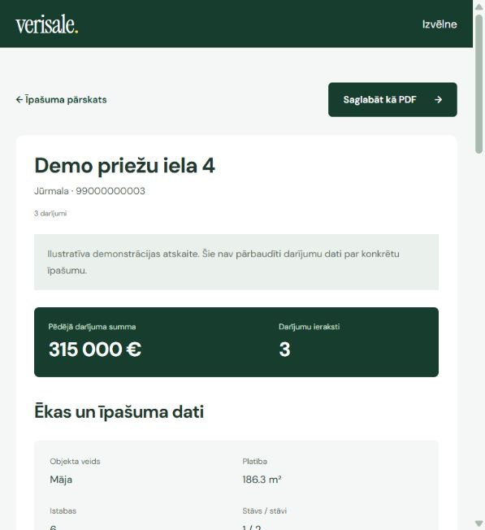

# VeriSale — Property History and Reports for Better-Informed Real Estate Decisions

VeriSale helps Latvian property buyers, sellers, and real estate professionals review a property's transaction history and technical details before a deal. It brings imported records into one searchable report, reducing the need to piece together information from separate documents.

**Live Demo / Video Walkthrough:** A public demo and walkthrough have not been published yet. After local setup, open [localhost:3000](http://localhost:3000/).

## Key Features

- **Property Search:** Find records by address, city, or cadastre number, with support for Latvian letters.
- **Readable Property Reports:** Review technical details, transaction dates, registered prices, and a price-history chart. Save reports as PDF using the browser's print dialog.
- **Verified Report Purchases:** Optional Stripe Checkout unlocks a €9.99 report for 24 hours in the purchasing browser session. Payment details and webhook signatures are checked on the server.
- **Reliable Data Import:** Import property records from CSV with row validation, duplicate-sale prevention, and a full rollback if an import fails.
- **Consistent User Experience:** Responsive Latvian pages share navigation, report sections, pricing, forms, and FAQs through reusable Blade components.
- **Ready-to-Explore Examples:** 12 free, clearly labelled fictional properties across 10 Latvian cities, with 36 sale records, let visitors explore the application without payment credentials.

The included records are illustrative. The application reads its own database; it does not currently fetch live property-registry records or provide market valuations. Professional and agency plans are contact enquiries rather than active subscriptions.



## Tech Stack

- **Frontend:** Laravel Blade, reusable components, plain CSS, and JavaScript; self-hosted DM Sans and Instrument Serif fonts.
- **Backend:** PHP 8.4+, Laravel 12, Eloquent ORM, and Laravel's HTTP client. Locally verified on PHP 8.4.27.
- **Database & Hosting:** SQLite for local development; Laravel's PHP development server. Public hosting is not configured.
- **Third-Party APIs:** Optional Stripe Checkout and signed webhooks. Contact email uses Laravel Mail with configurable SMTP.
- **Testing & Formatting:** PHPUnit feature tests, Laravel Pint, and a GitHub Actions workflow for tests, formatting, and dependency auditing.

## Technical Architecture & Decisions

- **Standard Laravel MVC keeps the code approachable.** Controllers validate requests and coordinate responses; Eloquent models manage records and relationships. Direct controller-to-model calls keep each flow easy to trace without repository layers or custom interfaces.
- **Blade components keep the design consistent with minimal tooling.** Shared heroes, section headings, report previews, pricing, and FAQs carry the same styling across pages. Plain CSS and JavaScript remove the need for a separate frontend build pipeline.
- **SQLite and database-backed purchases make local setup reproducible.** Migrations and seed data let reviewers run the app without a database service. Purchase records survive application restarts, while verified Stripe events control report access.

The main request flow is `routes/web.php` → controller → Eloquent model → Blade view. See [REFACTOR.md](REFACTOR.md) for the prototype-to-Laravel changes and [DESIGN.md](DESIGN.md) for the shared visual system.

## Local Setup

**Prerequisites:** A current patched PHP 8.4+ release, Composer 2, and PHP extensions including `curl`, `mbstring`, `openssl`, `pdo_sqlite`, `sqlite3`, `fileinfo`, and XML/DOM. Node.js is not required.

1. Clone the repository and enter the project:

   ```sh
   git clone https://github.com/Capzexe/Realstate-Platform.git
   cd Realstate-Platform
   ```

   **Windows shortcut after cloning:** install the verified project-local PHP 8.4.27 runtime, prepare the app, and start it:

   ```powershell
   .\scripts\install-php.ps1
   .\dev.ps1 setup
   .\dev.ps1 serve
   ```

   Run tests with `.\dev.ps1 test`. These helpers use the project runtime for PHP, Composer and the server. The runtime is ignored by Git. See [Windows runtime details](docs/PHP-RUNTIME.md). The standard commands below use an existing PHP 8.4+ installation on your PATH.

2. Install dependencies:

   ```sh
   composer install
   ```

3. Create your environment file:

   ```sh
   cp .env.example .env
   ```

   On Windows PowerShell, use `Copy-Item .env.example .env`. Keep `.env` private.

4. Generate the application key and create the SQLite database file:

   ```sh
   php artisan key:generate
   php -r "file_exists('database/database.sqlite') || touch('database/database.sqlite');"
   ```

5. Create the tables and demonstration records:

   ```sh
   php artisan migrate --seed
   ```

6. Start the local server:

   ```sh
   php artisan serve --host=127.0.0.1 --port=3000
   ```

Open [localhost:3000](http://localhost:3000/) and search for **Brīvības**, **Jūrmala**, **Liepāja**, or **Sigulda**. The local SQLite database contains 12 fictional apartments, houses and land plots with three sales each. All demo reports are free. Local contact messages are logged rather than emailed.

The repeatable dataset lives in [database/fixtures/properties.php](database/fixtures/properties.php). Run `php artisan db:seed` (Windows helper: `.\dev.ps1 php artisan db:seed`) to add missing examples without wiping records. Existing non-demo properties are never converted into free reports. Automated tests use a separate in-memory database; the local SQLite file and backups are never committed.

Run the checks and PHP formatter with:

```sh
composer test
composer format
```

The feature tests cover search, reports, access expiry, CSV imports, payment verification, webhook signatures, and contact validation. Tests use an in-memory SQLite database and fake HTTP responses.

The [PHP checks workflow](.github/workflows/tests.yml) runs on pushes and pull requests once this version is pushed to GitHub. Its commands have been checked locally; a hosted Actions run has not been triggered from this workspace.

Security hardening, findings, attack regression tests, and production Nginx/Apache/PHP configuration examples are documented in [the security audit](docs/SECURITY-AUDIT.md). Production requires a patched PHP runtime and deployment of the server settings; the local development server is not a production host.

To enable payments, set `STRIPE_SECRET_KEY` and `STRIPE_WEBHOOK_SECRET` in `.env`. Configure SMTP for actual email delivery. See [the setup guide](docs/SETUP.md) for CSV formats, Stripe webhook forwarding, email configuration, and deployment instructions.

## Future Improvements

- Add user accounts and a saved-report library so customers can recover purchased reports across devices.
- Connect an authorised property-data provider and schedule imports to keep records up to date.

Photography and font credits: [public/ASSETS.md](public/ASSETS.md).
